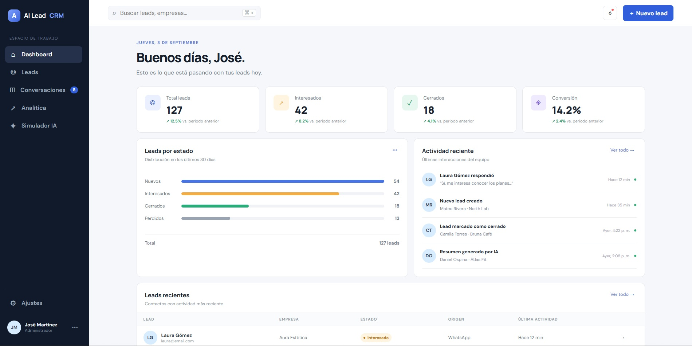

# AI Lead CRM

Primer vertical slice del CRM: cliente web, API y persistencia PostgreSQL.



## Requisitos

- Node.js 22+
- Docker con Docker Compose

## Inicio local

```bash
cp .env.example .env
docker compose up -d
npm install
npm run dev
```

El cliente queda en `http://localhost:5173` y la API en `http://localhost:3001`.

## API

`POST /api/leads`

```json
{
  "name": "Ada Lovelace",
  "email": "ada@example.com",
  "company": "Analytical Engines",
  "phone": "+57 300 123 4567",
  "source": "website"
}
```

`name` y `email` son obligatorios. La API devuelve `201` con el lead creado, `400` para datos inválidos y `409` si el correo ya existe.

| Método | Ruta | Resultado |
| --- | --- | --- |
| GET | `/api/leads` | `200`, `{ "data": [...] }`, ordenado del más reciente al más antiguo |
| GET | `/api/leads/:id` | `200`, `{ "data": lead }` |
| PATCH | `/api/leads/:id` | `200`, `{ "data": lead }` con los cambios persistidos |
| DELETE | `/api/leads/:id` | `204`, sin cuerpo |

El identificador debe ser un UUID válido (`400` en caso contrario). Las rutas por ID devuelven `404` si el lead no existe. `PATCH` requiere al menos un campo y permite cambiar `name`, `email`, `company`, `phone`, `source` y `status` (`new`, `contacted`, `qualified`, `won`, `closed`, `lost`). Los campos omitidos conservan su valor; enviar `""` en `company` o `phone` los limpia. Cada actualización modifica `updatedAt`; un correo duplicado devuelve `409`.

## Probar la aplicación y llenar PostgreSQL

1. Crea el archivo local de configuración desde PowerShell:

   ```powershell
   Copy-Item .env.example .env
   ```

2. Inicia PostgreSQL y confirma que el contenedor esté saludable:

   ```powershell
   docker compose up -d
   docker compose ps
   ```

3. Instala las dependencias e inicia el cliente y la API:

   ```powershell
   npm install
   npm run dev
   ```

4. En otra terminal, crea leads reales mediante la API. Cada petición debe usar un email diferente:

   ```powershell
   $lead = @{
     name = "Laura Gómez"
     email = "laura@email.com"
     company = "Aura Estética"
     phone = "+57 300 123 4567"
     source = "whatsapp"
   } | ConvertTo-Json

   Invoke-RestMethod `
     -Uri "http://localhost:3001/api/leads" `
     -Method Post `
     -ContentType "application/json" `
     -Body $lead
   ```

5. Comprueba directamente los registros guardados:

   ```powershell
   docker compose exec postgres psql -U postgres -d ai_lead_crm -c "SELECT id, name, email, company, status, source, created_at FROM leads ORDER BY created_at DESC;"
   ```

También puedes abrir `http://localhost:3001/health` para comprobar que la API está activa. El backend permite crear, listar, consultar, actualizar y eliminar leads en PostgreSQL mediante `/api/leads`; React consulta `GET /api/leads` al abrir la aplicación. El dashboard y la lista muestran los contactos y contadores de PostgreSQL, con estados de carga, error con reintento y lista vacía. El selector «Estado del lead» permite cambiar entre Nuevo, Contactado, Interesado, Cerrado y Perdido mediante `PATCH /api/leads/:id`. Interesado corresponde a `qualified`; Cerrado incluye `closed` y el estado anterior `won`. La conversión es cerrados / total × 100 (0.0% sin leads). Crear un lead desde React vuelve a consultar la API y muestra el contacto guardado. El botón «Marcar como cerrado» envía `PATCH /api/leads/:id` con `{ "status": "closed" }` y actualiza el detalle, la lista y los contadores tras guardar. Si falla, muestra un error y permite reintentar. Las conversaciones, el simulador y el análisis del detalle siguen siendo demostrativos. En producción, redirige `/api` al servidor de la API; en desarrollo lo hace Vite.

Para detener la aplicación usa `Ctrl+C`. La base de datos permanece en el volumen de Docker. `docker compose down` detiene PostgreSQL sin borrar los leads; `docker compose down -v` también elimina el volumen y todos sus datos.

## Comprobaciones

```bash
npm test
npm run typecheck
npm run build
```

## Migración de estados en bases existentes

Las bases nuevas ejecutan todas las migraciones al inicializar Docker. Para una base existente, aplica la migración que permite el estado `closed` (conserva compatibilidad con `won`):

```powershell
Get-Content server/db/migrations/002_add_closed_status.sql | docker compose exec -T postgres sh -c 'psql -v ON_ERROR_STOP=1 -U "$POSTGRES_USER" -d "$POSTGRES_DB"'
```
